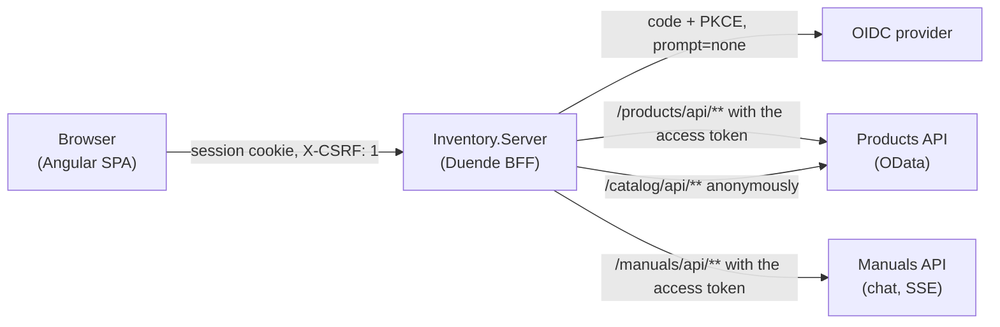

# Architecture

## Bird's-eye view

Inventory lets a user keep a private list of the products they own, browse a shared public catalog of those
products, and find a product's manual through an AI chat. It is an Angular 22 single-page app served by an ASP.NET
Core 10 Backend-for-Frontend (BFF) built on Duende BFF. The BFF holds every token; the browser holds only a session
cookie.

## Codemap

| Part | What it does |
|---|---|
| `Inventory.Server/Program.cs` | configuration, the OIDC handler, the three remote API endpoints, the production-only telemetry, logging and data protection |
| `Inventory.Server/Authentication/ListeningAddress.cs` | builds the OIDC redirect and post-logout URIs from the address the server listens on outside production |
| `Inventory.Server/Logging/`, `Telemetry/`, `Extensions/` | the Duende license-notice filter, request log levels, which requests are traced, required-setting reads |
| `inventory.client/src/app/` | the shell: routes, the HTTP interceptor (`X-CSRF: 1`, `X-Request-ID`, credentials), the silent-login iframe |
| `inventory.client/src/catalog/` | the anonymous catalog list and detail pages, their resolvers and the URL-held list state |
| `inventory.client/src/products/` | the signed-in product list, detail, create and edit forms, and the manual-finder chat panel |
| `inventory.client/src/auth/`, `user-session/`, `home/`, `nav-menu/`, `environments/`, `testing/` | the session service and guard, the claims page, the landing page, navigation, per-configuration values, unit-test helpers |
| `inventory.client/e2e/` | the Playwright journeys, the mock OIDC, Products and Manuals servers, and the synthetic walker ([TESTING.md](TESTING.md)) |
| `inventory.client/tools/stylelint/` | the stylesheet linter with its own lockfile, so its dependencies stay out of the client's |
| `Inventory.Tests.Unit/` | xUnit v3 tests of the server |
| `inventory.client.esproj`, `Inventory.Server.csproj` | build the client inside `dotnet build`; the `AngularConfiguration` property picks the Angular configuration |

## Sign-in

The BFF runs the OIDC Authorization Code flow with PKCE and `ResponseMode = query`, both bound from the
`OpenIdConnectOptions` section; startup fails unless `ResponseType` is `code`, because any other value silently
disables PKCE. A hidden iframe asks `/bff/login` with `prompt=none` on each load, so a visitor with a live provider
session is signed back in without a click; `query` response mode lets that check finish inside the frame. The SPA
reads its session from `/bff/user`.

## Pages

| Route | Who | Backed by |
|---|---|---|
| `/` | anyone | the landing page |
| `/catalog`, `/catalog/:id` | anyone | Products' `CatalogProducts` OData set through `/catalog/api/**` |
| `/products`, `/products/new`, `/products/:id`, `/products/:id/edit` | signed in | Products' inventory items through `/products/api/**` |
| `/user-session` | anyone | the session's claims |

- **The catalog list's state lives in the URL**: `q`, `orderBy`, `orderDir` and `page` are query parameters, and the
  route's resolver loads each page, so a list never fetches on its own and a deep link opens on the page it names.
  The router restores the scroll position on Back.
- **Editing a product sends two PATCHes** built from the dirty controls: owner-private fields to the inventory item,
  shared facts to its catalog product. An empty change set sends nothing.
- **The manual-finder chat panel** on the create and edit forms creates a chat on the Manuals API, titles it from the
  product, and streams the assistant's reply over server-sent events with `fetch` (not `EventSource`, so the cookie
  and `X-CSRF` header are sent). A manual URL in a reply becomes a chip that fills the form's `manualUrl`.

## Invariants

- The browser never holds an access token; every API call carries `X-CSRF: 1`, including the anonymous catalog.
- `OpenIdConnectOptions:ResponseType` is `code`, enforced at startup.
- Every page's data arrives through a resolver; a resolver that fails resolves `null` and the page renders its error.
- Selectors are element ids, bound from shared constants the template, specs and walker all import.
- The design rules in [DESIGN.md](DESIGN.md) govern every UI change.

## Boundaries

Each dependency is one required setting, read in `Inventory.Server/Program.cs`, so a local stand-in is a different URL:

- **The OIDC provider** (`OidcAuthority`): the BFF is a confidential client running code + PKCE.
- **The Products API** (`ProductsApiAddress`): `/products/api/**` is forwarded with the user's access token and
  `/catalog/api/**` anonymously, both by `MapRemoteBffApiEndpoint`.
- **The Manuals API** (`ManualsApiAddress`): `/manuals/api/**` is forwarded with the access token, including the
  server-sent-event stream of a chat reply.

## Cross-cutting concerns

Azure App Service. In production the BFF signs in to Azure with `DefaultAzureCredential`, reads its secrets from Key
Vault-referenced App Service settings, keeps data-protection keys in Blob Storage encrypted with a Key Vault key,
exports traces and metrics over OTLP to `AlloyEndpoint`, and ships logs to Elasticsearch with Serilog.
